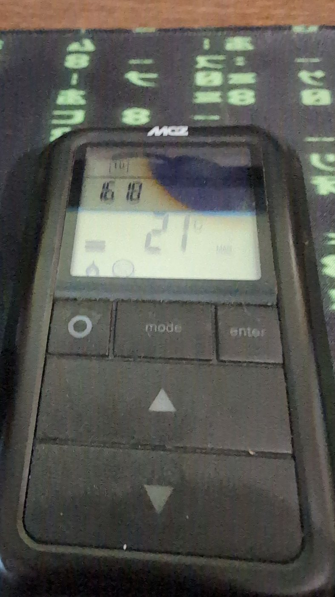

# Télécommande connectée pour poêle à pellets MCZ (ESP32 + CC1101)

Piloter un poêle à pellets **MCZ Musa / Club Comfort Air 2.0** (télécommande « MAX LCD », 434,5 MHz) depuis un téléphone, un PC ou une tablette, avec un ESP32 et un module radio CC1101 — en gardant la télécommande d'origine, ou en la remplaçant.

À notre connaissance, **le protocole radio de ces poêles n'était documenté nulle part**. Ce dépôt le décrit en détail (structure des trames, champs, contrôle, tables, comportements AUTO / ECO / NO AIR) et contient tout le code pour le reproduire.

## Ce que ça fait

- Marche / arrêt, puissance de flamme (1 à 5), 3 ventilateurs (0 à 5 ou AUTO), modes MAN, AUTO, ECO, NO AIR.
- Minuteur (« éteindre dans 2 h ») et programmation hebdomadaire.
- Fonctionne **avec** la télécommande d'origine (ce qu'on règle sur l'une est repris par l'autre) ou **à sa place** (thermostat dans l'ESP32 avec sonde de température DHT22).
- Application web installable sur téléphone, page de secours dans l'ESP32 (Wi-Fi propre, portail captif).
- Mise à jour du firmware par Wi-Fi (OTA).

## Pour commencer

| Je veux… | Lire |
|---|---|
| comprendre la méthode (et l'appliquer à un autre appareil) | [docs/TUTO.md](docs/TUTO.md) |
| reproduire le projet pas à pas | [docs/REPRODUIRE.md](docs/REPRODUIRE.md) |
| les trames, champs, tables de contrôle, exemples | [docs/PROTOCOLE.md](docs/PROTOCOLE.md) |
| installer le serveur et l'application web | [docs/SERVEUR.md](docs/SERVEUR.md) |
| comprendre / compiler le firmware | [docs/FIRMWARE.md](docs/FIRMWARE.md) |
| le mode secours de l'ESP32 | [docs/MODE_SECOURS.md](docs/MODE_SECOURS.md) |
| éviter les pièges déjà rencontrés | [docs/PIEGES.md](docs/PIEGES.md) |
| l'histoire du projet | [docs/JOURNAL.md](docs/JOURNAL.md) |

## Contenu du dépôt

| Dossier | Contenu |
|---|---|
| `firmware/etape9_emission/` | firmware Arduino de l'ESP32 : écoute, décodage, émission, thermostat, secours, OTA |
| `web/` | application web et API PHP + SQLite (Raspberry Pi ou tout Apache + PHP) |
| `analyse/` | scripts Python : décodage, modèle linéaire, génération des tables |
| `docs/` | documentation, captures brutes, photos |

## Matériel

ESP32 DevKit + module CC1101 433 MHz (avec antenne), 7 fils, option : capteur DHT22 et un serveur (Raspberry Pi). Coût total : de l'ordre de 15 à 20 euros sans serveur. Câblage : [docs/REPRODUIRE.md](docs/REPRODUIRE.md#2-câblage-esp32--cc1101).

## Statut

Validé en réel sur un poêle MCZ Musa Comfort Air 2.0 : écoute, émission, cohabitation avec la télécommande, thermostat AUTO, NO AIR, ECO. Le mode TIMER de la télécommande n'est pas décodé. Compatibilité avec d'autres modèles MCZ : **non testée** (voir « Ce qui peut différer » dans [docs/PROTOCOLE.md](docs/PROTOCOLE.md)).

Retours d'expérience sur d'autres modèles bienvenus.

## Avertissement

Un poêle est un appareil de chauffage. Éprouvez chaque automatisme en étant présent et ne laissez rien l'allumer sans surveillance tant qu'il n'est pas éprouvé. Projet personnel de rétro-ingénierie sur du matériel qui appartient à l'auteur, sans lien avec le fabricant MCZ ; « MCZ », « Musa », « Club » et « MAX LCD » sont des noms de leurs propriétaires, cités uniquement pour désigner le matériel compatible. Aucune garantie : vous l'utilisez à vos risques.

## Comment ce projet a été fait

Le décodage des trames (structure, champs, contrôle XOR-linéaire, tables) et le code ont été réalisés par Jean-Philippe PAREIN **avec l'aide de Claude Code** (assistant d'IA d'Anthropic). Les captures, les essais sur le poêle et toutes les validations en réel ont été faits par l'auteur, sur son propre matériel.

## Licences et attribution

- Code (`firmware/`, `web/`, `analyse/`) : licence **MIT**, voir [LICENSE](LICENSE).
- Documentation et photos (`docs/`, ce README) : **CC BY 4.0**, voir [LICENSE-DOCS.md](LICENSE-DOCS.md).

Dans les deux cas, merci de citer l'auteur : **Jean-Philippe PAREIN** (GitHub : jpparein), avec un lien vers ce dépôt.
