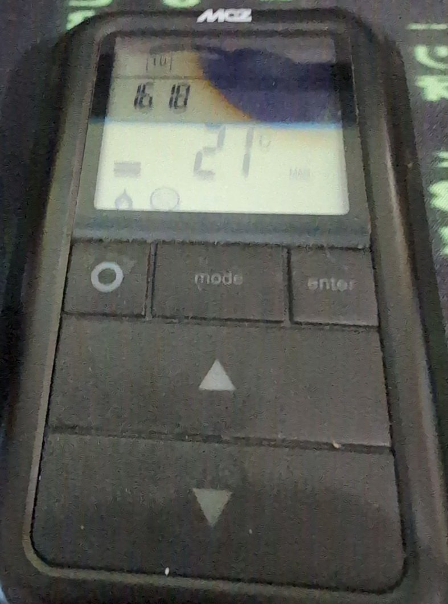
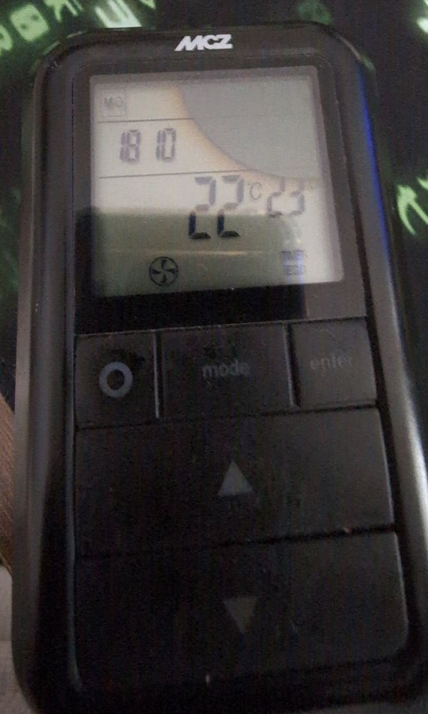
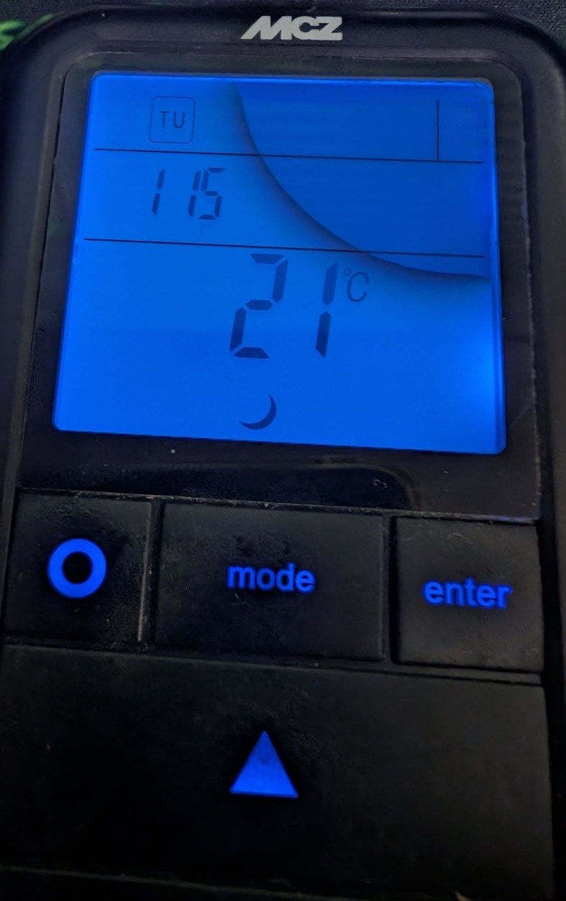
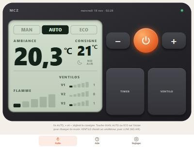
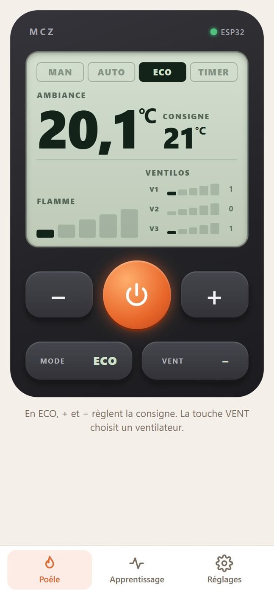
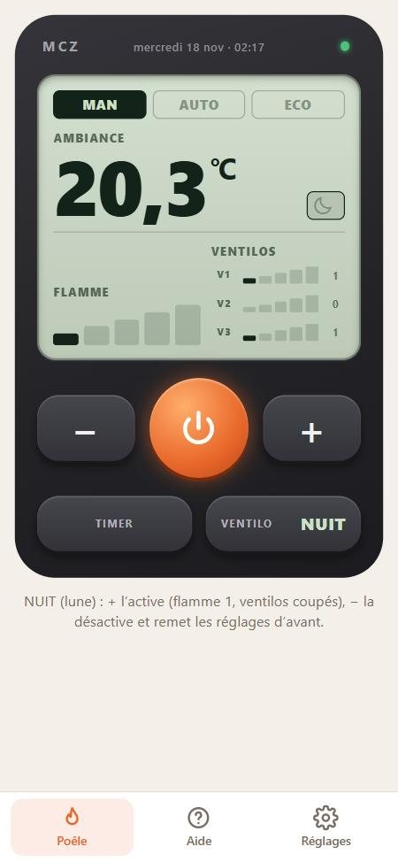

# Tutoriel : comment on a retrouvé le protocole d'un poêle MCZ

Ce tutoriel raconte la méthode, pour que vous puissiez l'appliquer à ce poêle **ou à un autre** poêle/appareil à télécommande 433 MHz. Pour reproduire le projet tel quel, suivez [REPRODUIRE.md](REPRODUIRE.md). Pour les valeurs précises, voir [PROTOCOLE.md](PROTOCOLE.md).

> Le décodage des trames a été réalisé avec l'aide de Claude Code (IA d'Anthropic) ; les captures et les essais réels sont de l'auteur.

## Le principe

Une télécommande radio envoie des trames. Si l'on sait les enregistrer, les comprendre et en fabriquer de nouvelles, un ESP32 peut jouer le rôle de la télécommande. Quatre étapes :

1. **Écouter** : trouver la fréquence et la modulation.
2. **Enregistrer** : durées des états haut et bas du signal.
3. **Comprendre** : codage des bits, structure, champs, contrôle.
4. **Émettre** : refabriquer une trame correcte et la rejouer.

| Télécommande MAX LCD | Écran allumé | Rétroéclairage |
|---|---|---|
|  |  |  |

## 1. Fréquence et modulation

La notice de la télécommande donne 434,5 MHz. On le confirme au RSSI du CC1101 : en appuyant sur une touche, le niveau reçu monte à la bonne fréquence. La modulation est **OOK** : on teste d'abord le 2-FSK, qui ne donne que du bruit, puis l'OOK.

## 2. Enregistrer les impulsions

Le CC1101 en mode « série asynchrone » (`PKTCTRL0 = 0x32`) met sur GDO0 le signal brut démodulé. L'ESP32 mesure la durée de chaque état entre deux fronts. Un histogramme des durées montre trois familles : **~422 µs, ~843 µs, ~1265 µs** : une unité de base et ses multiples 1, 2 et 3.

## 3. Comprendre le codage

1. **Biphase mark** : transition à chaque frontière de bit, transition supplémentaire au milieu pour un `1`. Un bit = 2 unités.
2. Les impulsions de 3 unités sont une **synchro** qui précède chaque bloc de 12 bits. 7 blocs = une trame ; la trame est répétée 5 fois.
3. Chaque bloc de 12 bits : un **XOR cumulé** donne 9 bits de données, un bit de parité impaire et `11`. Quand la parité et le `11` sont vrais sur tous les blocs de toutes les trames, le décodage est juste (aucune chance que ce soit un hasard).
4. Les 3 premiers blocs ne changent jamais : c'est **l'adresse** de la télécommande.

## 4. Retrouver ce que veulent dire les bits

Méthode : **un seul réglage à la fois**. On note à l'écran de la télécommande la valeur, on capture la trame. Au bout d'une trentaine de captures, on compare les trames deux à deux : les bits qui changent appartiennent au champ modifié.

Cela a donné : ventilateur 1 (3 bits), flamme (3 bits), mode (3 bits), drapeau, ventilateur 2 et 3 (4 bits chacun), avec quelques décalages constants (`⊕ 2`, `⊕ 5`) propres au codage.

## 5. Le contrôle : le piège qui s'est révélé simple

Les 18 bits des blocs 6 et 7 changent chaque fois qu'on change un réglage, et aucune somme ou parité simple ne marchait. Le déclic : tester si **chaque bit de contrôle est un XOR de bits d'état**. Un système d'équations sur le corps à deux éléments (résolution de Gauss, `analyse/lin.py`) répond oui, avec rang 14 pour 19 inconnues sur les premières trames. Conséquence pratique : *changer un champ ajoute toujours la même différence au contrôle*. Il n'est donc pas nécessaire de connaître la formule ; une table de différences par champ suffit (`mcz_tables.h`).

Vérification : on **prédit** la trame d'un réglage qu'on n'a jamais capturé, puis on appuie sur la télécommande, et on compare. Bit pour bit identique.

## 6. Fabriquer une trame

Départ : la dernière trame réelle. On change **un champ**, on ajoute la différence de contrôle, on recalcule parité et XOR cumulé, on reconstruit les impulsions (synchro, biphase mark, 5 répétitions, silence de 4586 µs). On rejoue les durées sur GDO0 avec le CC1101 en émission OOK.

Avant d'émettre, on valide **hors-ligne** : 156 changements de réglage reconstruits à partir d'une autre trame, tous identiques à la trame réelle ; l'ESP32 rejoue 12 de ces cas à chaque démarrage.

## 7. Le comportement, pas seulement les trames

Les trames ne disent pas tout : il faut aussi observer **quand** la télécommande les envoie.

- En AUTO, la télécommande **est** le thermostat : elle monte ou descend la puissance d'un cran par minute en comparant consigne et température. La consigne n'est pas dans le signal.
- En ECO, elle envoie une trame « flamme 0 » 20 minutes après la consigne, et rallume à consigne − 2 °C.
- Pour NO AIR, une trame est envoyée 5 minutes après l'activation pour couper les ventilateurs : le poêle ne le fait pas seul.

Pour remplacer la télécommande, l'ESP32 reproduit ces règles avec un capteur de température.

| Télécommande à l'écran (AUTO) | Mode ECO | Mode nuit (NO AIR) |
|---|---|---|
|  |  |  |

## 8. Faire tenir ensemble télécommande et application

Voir [REPRODUIRE.md](REPRODUIRE.md) (étape H) : la télécommande renvoie tout son état à chaque trame, il faut donc fusionner ce qui change.

## 9. Appliquer la méthode à un autre appareil

1. Fréquence et modulation (RSSI, notice).
2. Histogramme des durées : trouver l'unité.
3. Trouver le codage (biphase mark, Manchester, PWM, …) : le bon codage donne des blocs de longueur constante et une structure stable.
4. Chercher la parité et les motifs fixes de fin de bloc.
5. Une modification à la fois, et un tableau des captures.
6. Tester la linéarité (XOR) du contrôle avant de chercher une formule.
7. Valider hors-ligne avant d'émettre, puis émettre avec une seule fonction visible.

## Photos

Matériel : [`photos/materiel`](photos/materiel) — câblage : [`photos/cablage`](photos/cablage) — télécommande : [`photos/telecommande`](photos/telecommande) — application : [`photos/application`](photos/application).
